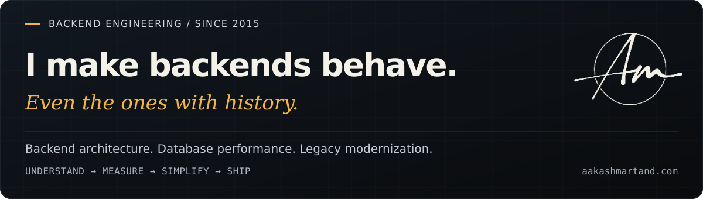

# Aakash Martand

**Senior Software Engineer at i3 Verticals · Vadodara, India · Building production backends since 2015.**

I build APIs, untangle legacy systems, tune databases, and help teams ship changes they can maintain. My work spans fintech, gaming, SaaS, healthcare, and logistics—from PHP 4 modernization to backend modules on a fintech platform serving **3M+ users**.

I like an interesting engineering problem. I like an uneventful deployment even more.

[Website](https://aakashmartand.com/) · [Résumé](https://aakashmartand.com/assets/resume.pdf) · [LinkedIn](https://www.linkedin.com/in/aakashmartand/) · [Email](mailto:aakashmartand@gmail.com)

---

## A few things that made it to production

| Context | What I worked on | Outcome |
| --- | --- | --- |
| **Fintech at scale · mPokket** | Backend modules for onboarding, collections, call scheduling, and customer support. | Supported workflows on a platform serving **3M+ users**; contributed to improvements that reduced downtime by **20%**. |
| **Performance & delivery · ZoodPay** | High-traffic query tuning, backend workflow optimization, and deployment automation. | Approximately **30% improvement in API response times** and **50% shorter deployment time**. |
| **Risk engineering · ZoodPay** | API-driven eKYC with the Risk Engineering team, including a Pakistan-specific verification module. | **40% improvement in successful verification rates** and **25% fewer fraud cases**. |
| **Team leadership · B.R. Softech** | Led **4 PHP developers**, established coding standards, and reverse-engineered business-critical modules. | **7 major product releases**, delivered on schedule. |

These are outcomes from my professional work; the [résumé](https://aakashmartand.com/assets/resume.pdf) and [experience page](https://aakashmartand.com/#experience) provide the context.

## My engineering defaults

**Read the query plan before ordering more servers.** Profile the workload, understand the indexes, and measure the change. Database tuning has been a recurring part of my work across fintech and gaming.

**Treat legacy code as undocumented business knowledge.** Understand the behavior before changing it. I've reverse-engineered critical modules and refactored PHP 4 systems. Some archaeology comes with a deployment pipeline.

**Make the release repeatable.** If a deployment depends on remembering the right sequence of manual steps, that sequence belongs in automation.

**Leave the team stronger.** Useful code reviews, clear decisions, and shared standards make the next change easier for somebody else. Mentorship has been part of my work at B.R. Softech, ZoodPay, and i3 Verticals.

## Tools I reach for

| Work | Working set |
| --- | --- |
| **Backend & APIs** | PHP, Laravel, CodeIgniter, REST APIs, OOP |
| **Data & performance** | MySQL, PostgreSQL, Redis, MongoDB, stored procedures, indexing, query tuning |
| **Systems & delivery** | Linux, LAMP, Apache, NGINX, DigitalOcean, Linode, Git, deployment automation |
| **Quality & collaboration** | PHPUnit, code review, technical planning, mentorship |

**Currently learning:** Go, Docker, cloud services, and orchestration. **Further interests:** Rust, distributed systems, and AI/ML integration.

<strong>The longer version: six companies, plenty of context</strong>

| When | Where | Engineering chapter |
| --- | --- | --- |
| **Mar 2024–present** | **i3 Verticals** · Senior Software Engineer | Platform capabilities, legacy optimization, backend architecture, and developer mentorship. Contributed to a **35% improvement in system performance**. |
| **Jul 2022–Jan 2024** | **Bharti Softech · ZoodMall & ZoodPay** · Senior Software Engineer | eKYC, risk workflows, API performance, and deployment automation. |
| **Jul 2021–Jun 2022** | **mPokket** · Senior Software Engineer | High-volume fintech workflows, backend reliability, and scalable system improvements. |
| **Aug 2019–Jun 2021** | **B.R. Softech** · Senior PHP Developer | Team leadership, gaming platforms, coding standards, and legacy modernization. |
| **Jun 2017–Jul 2019** | **Mobzway Technologies** · PHP Developer | Casino administration, multi-level access control, real-time monitoring, and commission management. Stored procedures and database work improved data processing efficiency by **over 70%**. |
| **May 2015–May 2017** | **Microlent Systems** · PHP Developer | Logistics automation for Clockwork Express, healthcare APIs for Dental Pro, and PHP 4 modernization for the Institute of Brunei Technical Education. |

## Next on the workbench

My public portfolio is taking shape. The first planned studies each start with an engineering question:

- **MySQL hierarchy lab:** Which tree model holds up when reads, subtree moves, and storage all count?
- **Inventory reservations:** What happens when two requests both want the last item?
- **Webhook dispatcher:** What can you promise when the receiver processed the request but the acknowledgement never arrived?

These are planned projects. As they ship, I'll add the code, experiments, failure cases, and decisions here.

---

**Have a slow query, a complicated migration, or a backend team to grow?** [Let's talk.](mailto:aakashmartand@gmail.com)

Good systems make the difficult parts look uneventful.
